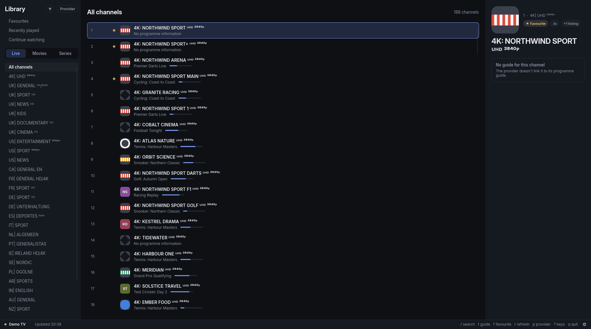
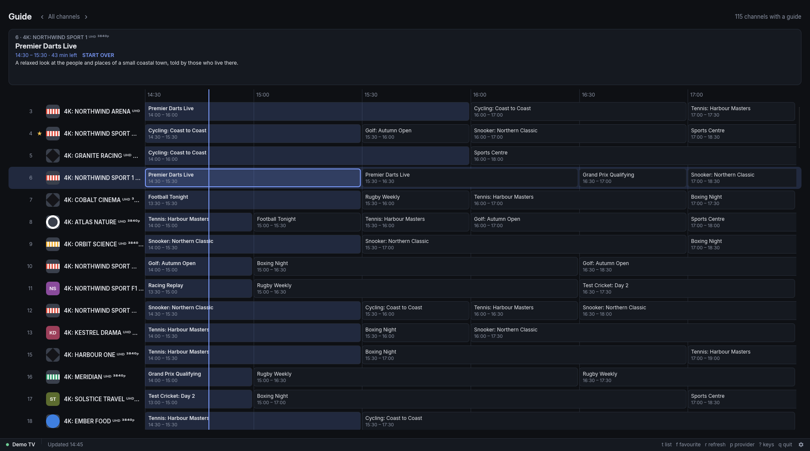
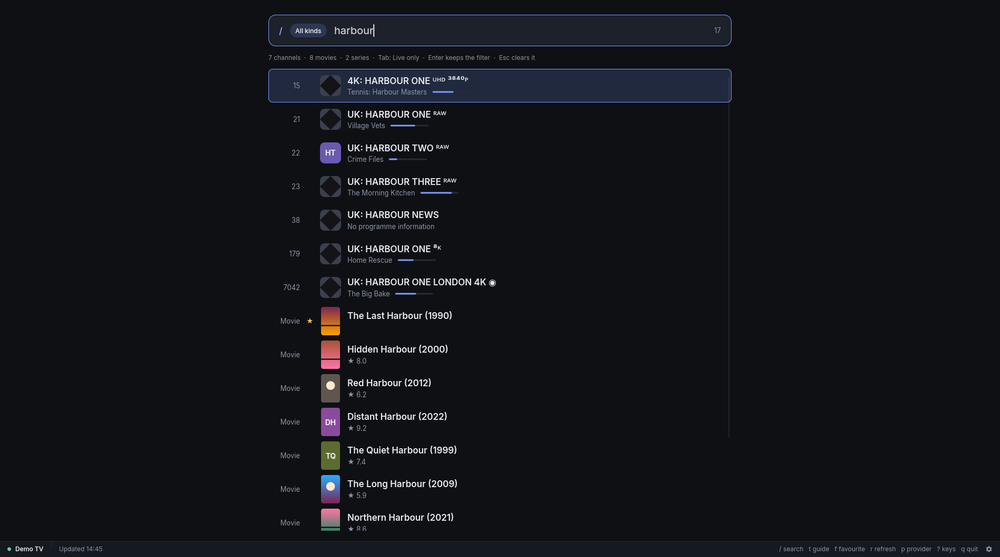
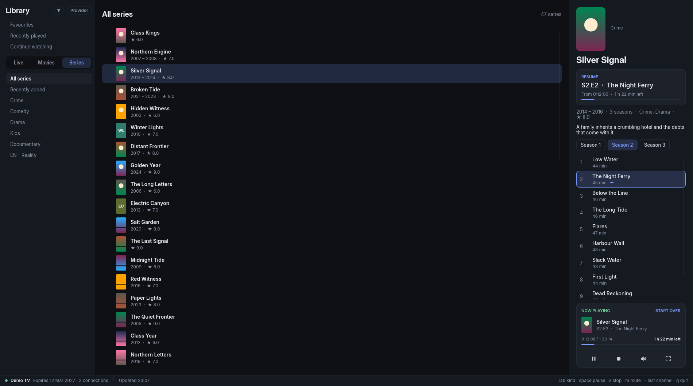
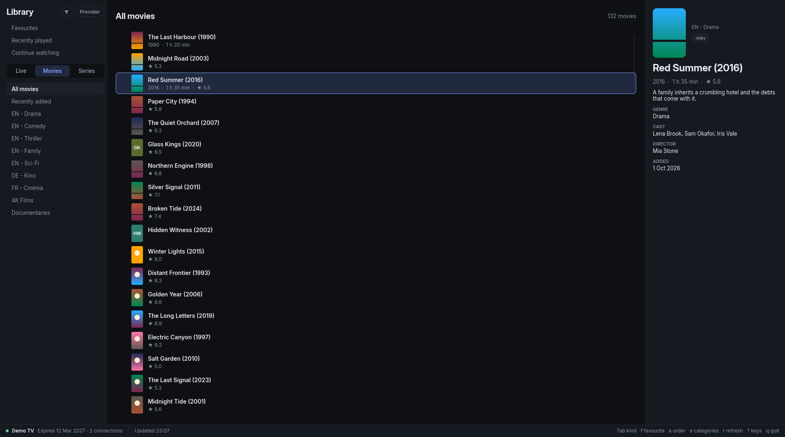
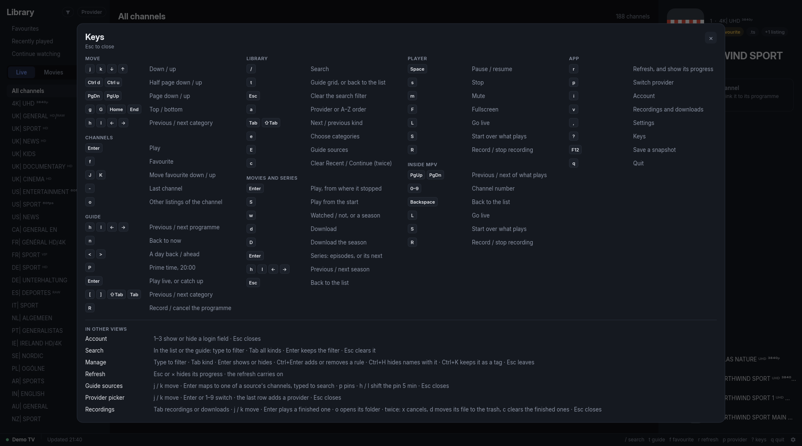
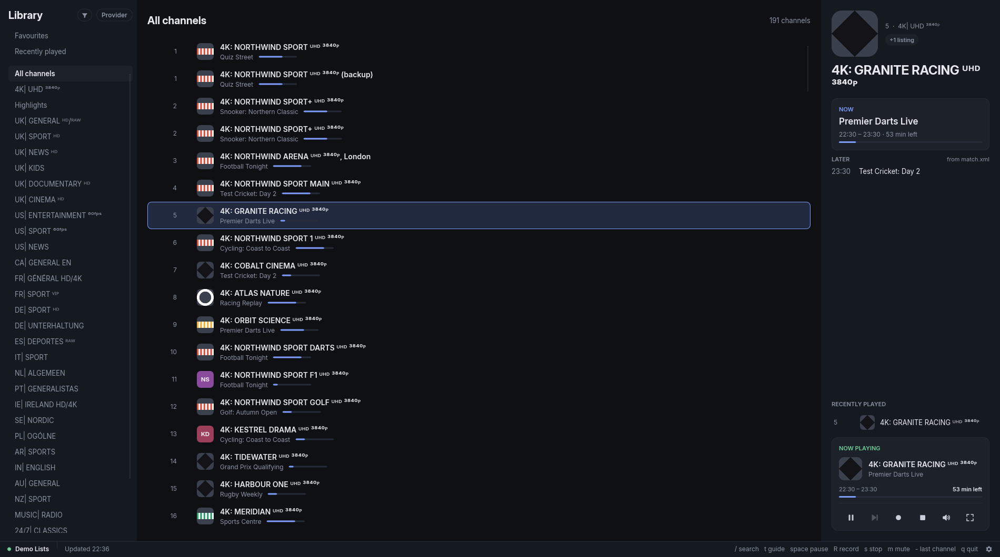
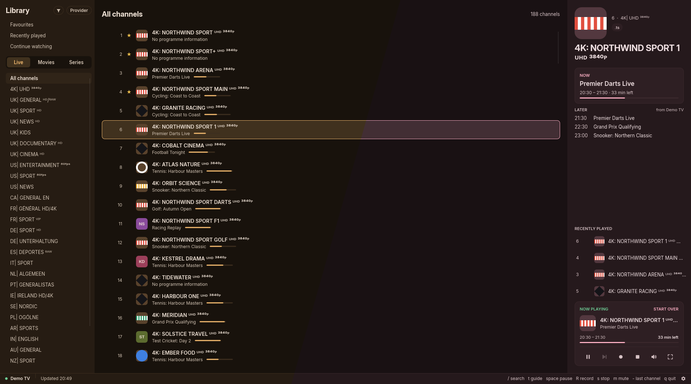

<p align="center">
  
</p>

<h1 align="center">Vidicon</h1>

<p align="center"><em>A fast, keyboard-driven IPTV player for Linux.</em></p>

<p align="center">
  <a href="https://github.com/emzbtw/vidicon/releases/latest"></a>
  <a href="#nixos"></a>
  
  
  
  <a href="LICENSE"></a>
</p>

<p align="center">
  <a href="https://emzbtw.github.io/vidicon/">Website</a> ·
  <a href="#install">Install</a> ·
  <a href="#first-run">First run</a> ·
  <a href="#keys">Keys</a> ·
  <a href="#reporting-a-bug">Reporting a bug</a> ·
  <a href="#disclaimer">Disclaimer</a>
</p>

Vidicon browses an Xtream Codes provider's live channels, guide, movies and
series, or the channels of an M3U playlist, and plays them in mpv.



Vidicon ships no channels, playlists or streams, and points to none. You
bring your own provider account ([Disclaimer](#disclaimer)).

## What it does

- Live channels by the provider's categories, with what is on now and next.
- A guide grid, scrollable through the days the provider sends.
- Fuzzy search over channels, movies and series.
- Favourites, recently played, and a last-channel key.
- Catch-up on channels the provider archives.
- Scheduled recordings, made by ffmpeg.
- Movies and series, with resume and downloads.
- External XMLTV guide sources, matched to channels by id or name.
- Reconnects a dropped stream, and lists a channel's other listings.
- Colours from your Noctalia scheme or wallpaper, following it live.
- Keyboard first (vim keys and arrows), with full mouse support.

It stays fast with large providers: on 50k channels the first frame is
under 300 ms from the local database (about 190 ms measured), and search
filters in under 8 ms a keystroke.



<table>
  <tr>
    <td width="50%"><br><sub>Search across channels, movies and series</sub></td>
    <td width="50%"><br><sub>A series and its episodes</sub></td>
  </tr>
  <tr>
    <td width="50%"><br><sub>Movies</sub></td>
    <td width="50%"><br><sub>Every key, one press of <code>?</code> away</sub></td>
  </tr>
</table>

## What it does not do

- **Stalker portals.** Xtream Codes and M3U playlists are the only sources
  ([`docs/adr/0001-xtream-only-source.md`](docs/adr/0001-xtream-only-source.md)).
- **Catch-up, movies or series from an M3U playlist.** Its entries are all
  live channels.
- **Play video itself.** mpv opens in its own window, driven over its IPC
  socket ([`docs/adr/0002-external-mpv-over-ipc.md`](docs/adr/0002-external-mpv-over-ipc.md)).
- Windows, macOS, mobile or TV.

## Install

### NixOS

Add the flake as an input:

```nix
# flake.nix
inputs.vidicon = {
  url = "github:emzbtw/vidicon";
  inputs.nixpkgs.follows = "nixpkgs";
};
```

and the package to a module (with `inputs` passed through `specialArgs`):

```nix
environment.systemPackages = [
  inputs.vidicon.packages.${pkgs.stdenv.hostPlatform.system}.default
];
```

With home-manager, put the same package in `home.packages` instead. The
URL follows `main`; append `/vX.Y.Z` to pin a release. Your `flake.lock`
holds the version until `nix flake update vidicon`. If your nixpkgs is
older than vidicon needs (Rust 1.92), drop the `follows` line.

The package brings mpv, ffmpeg and the Inter font, and adds a desktop
entry. An mpv or ffmpeg already on your `PATH` comes first, with its config
and scripts.

### Other systems with Nix

```sh
nix profile add github:emzbtw/vidicon    # Nix before 2.30: nix profile install
```

This installs the same package as on NixOS, desktop entry included. To try
it without installing:

```sh
nix run github:emzbtw/vidicon
```

### Debian and Ubuntu

On Debian 12, Ubuntu 22.04 or newer, install the .deb from the
[latest release](https://github.com/emzbtw/vidicon/releases/latest):

```sh
curl -LO https://github.com/emzbtw/vidicon/releases/latest/download/vidicon_amd64.deb
sudo apt install ./vidicon_amd64.deb
```

It pulls in mpv, ffmpeg and Inter as dependencies. Ubuntu 22.04's Inter is
3.19, which lacks Inter Display, so headings use another font there.

### Fedora

On Fedora 43 or newer, install the .rpm:

```sh
sudo dnf install https://github.com/emzbtw/vidicon/releases/latest/download/vidicon.x86_64.rpm
```

It pulls in mpv, ffmpeg and Inter as dependencies.

### Arch Linux

Build the package from the repo's PKGBUILD:

```sh
git clone https://github.com/emzbtw/vidicon
cd vidicon/packaging/aur/vidicon
makepkg -si
```

It downloads the tagged release, builds it, and installs mpv, ffmpeg and
Inter as dependencies. `packaging/aur/vidicon-git` builds the latest `main`
instead.

### From source

To build on any distribution, you need:

- Rust 1.92 or newer, to build
- mpv, for playback
- ffmpeg, for recordings and downloads
- fontconfig
- Inter 4.0 or newer (older versions lack Inter Display, and headings fall
  back to another font)
- a Wayland or X11 session

```sh
cargo build --release --no-default-features
./target/release/vidicon
```

`--no-default-features` leaves out the developer tooling (screenshots, key
replay, the `--probe-*` flags).

The [latest release](https://github.com/emzbtw/vidicon/releases/latest)
also has a tarball with a prebuilt binary and the desktop entry, for any
distribution with glibc 2.35 or newer and the runtime dependencies above,
and a `SHA256SUMS` file.

## First run

With no credentials file, Vidicon opens a form for a provider. Pick its
type: Xtream takes the server URL, username and password, and saves them
once the account checks out; M3U takes a playlist URL or path, and saves
it once the playlist reads. Settings (`,`) adds more providers, edits
them, and adds guide sources.

| What | Path |
|---|---|
| Credentials | `$XDG_CONFIG_HOME/vidicon/credentials.toml` (`0600`, in a `0700` directory) |
| Settings | `$XDG_CONFIG_HOME/vidicon/config.toml` |
| Database | `$XDG_DATA_HOME/vidicon/vidicon.db` |

`--credentials <path>` or `VIDICON_CREDENTIALS` reads the credentials from
another file. Vidicon refuses a credentials file that other users can read.

### M3U providers

An M3U provider in `credentials.toml`, as the form writes it:

```toml
[[provider]]
id = "lists"
name = "My lists"
type = "m3u"
url = "https://lists.example.net/tv.m3u"  # or an absolute path
user_agent = "Example/1.0"                # optional
```

Every entry is a live channel, in its `group-title` category. The guide
comes from the feeds the playlist names in its `#EXTM3U` line
(`url-tvg` or `x-tvg-url`), and from any guide sources you add. A URL is fetched again
on the refresh schedule; a file is read again when it changes. An M3U
provider has no account, catch-up, movies or series, and the app hides
them.



A playlist URL from an Xtream panel (`get.php?username=...&password=...`)
is better added as Xtream: the form offers to, and that also gives the
guide, catch-up, movies and series.

## Keys

| Key | Does |
|---|---|
| `j` `k` or arrows | Move |
| `Enter` | Play |
| `/` | Search (`Tab` widens it to all channels, and to movies and series where there are any) |
| `t` | Guide grid, or back to the list |
| `f` | Favourite |
| `-` | Last channel |
| `Space` | Pause / resume |
| `m` | Mute |
| `F` | Fullscreen |
| `R` | Record what plays, or the selected programme in the guide |
| `<` `>` | A day back / ahead in the guide |
| `r` | Refresh |
| `,` | Settings |
| `q` | Quit |

Press `?` in the app for all of them.

## Themes

`theme = "default"` in `config.toml` is Vidicon's own dark palette.
`theme = "noctalia"` takes the colours from
[Noctalia](https://noctalia.dev)'s scheme or wallpaper, and follows them
as they change. Settings (`,`) has the same switch under General.

Noctalia needs Vidicon's template once. Save
[`contrib/noctalia/vidicon.toml`](contrib/noctalia/vidicon.toml) as
`~/.config/vidicon/noctalia-template.toml` (not in `~/.config/noctalia/`,
where Noctalia reads every `.toml` as its own config), and add to
Noctalia's `config.toml`:

```toml
[theme.templates.user.vidicon]
input_path = "~/.config/vidicon/noctalia-template.toml"
output_path = "~/.config/vidicon/noctalia-palette.toml"
```

`noctalia theme --list-templates` then lists `vidicon` under User
templates. On each scheme or wallpaper change Noctalia writes
`noctalia-palette.toml`, and Vidicon applies it within a second. Until
that file exists, the Theme field in Settings says `No Noctalia palette
at <path>`.

Vidicon stays dark when Noctalia is in light mode, and keeps its own
colours for warnings, errors, favourites and the online dot.



## Reporting a bug

Say which view you were in and what you pressed. Logs go to stderr:

```sh
RUST_LOG=vidicon=debug vidicon 2> vidicon.log
```

Logs leave out passwords and stream URLs, but they name channels,
programmes and image hosts. Read the log before you attach it.

Every Xtream provider differs a little. If something fails only on your
provider, say so.

## Disclaimer

Vidicon is a player. It ships no channels, playlists, streams or guide
data, and points to no sources of them. It is not affiliated with any IPTV
provider, or with Xtream Codes.

The screenshots show a demo provider: the channels, programmes and posters
in them are invented.

You are responsible for having the right to watch what your provider
streams. Issues asking where to find streams or providers are closed.

## Credits

Vidicon is built on:

- [Slint](https://slint.dev): the UI toolkit.
- [mpv](https://mpv.io): playback.
- [FFmpeg](https://ffmpeg.org): recordings and downloads.
- [SQLite](https://sqlite.org), through
  [rusqlite](https://github.com/rusqlite/rusqlite): the local database.
- [Inter](https://rsms.me/inter/) by Rasmus Andersson (OFL-1.1): the
  typeface.
- [femtovg](https://github.com/femtovg/femtovg): the renderer. A patched
  copy is in `vendor/femtovg` (`vendor/README.md`).
- [nucleo](https://github.com/helix-editor/nucleo), from the Helix editor:
  fuzzy matching.
- [tokio](https://tokio.rs) and [reqwest](https://github.com/seanmonstar/reqwest):
  the async runtime and HTTP.
- [Noctalia](https://noctalia.dev): the palettes behind
  `theme = "noctalia"`, rendered from Vidicon's template.

`Cargo.lock` has the full list of dependencies.

Vidicon was written with the help of AI coding assistants.

<a href="https://slint.dev">
  <picture>
    <source media="(prefers-color-scheme: dark)" srcset="docs/slint/MadeWithSlint-logo-light.svg">
    
  </picture>
</a>

## Licence

GPL-3.0-or-later (`LICENSE`).
