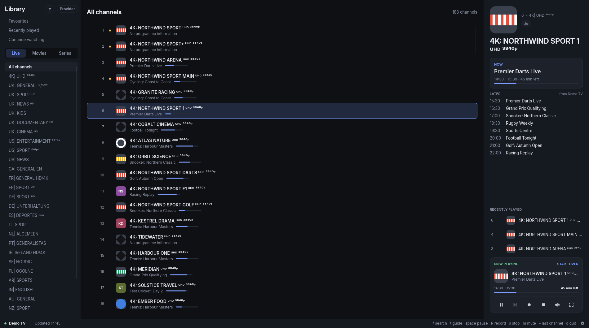
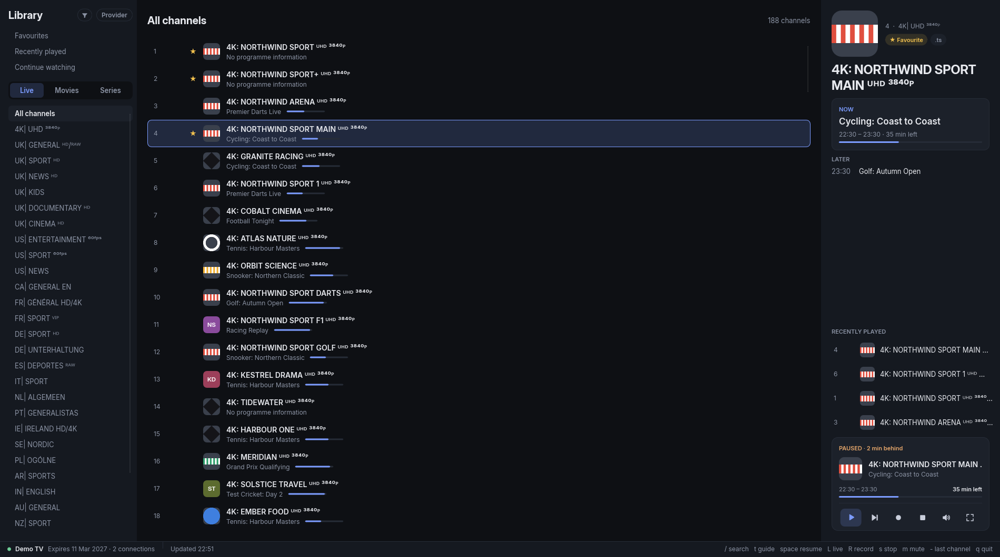

import { Aside } from '@astrojs/starlight/components';
// The README's Disclaimer section, as generated by readme-pages.mjs.
import { Content as Disclaimer } from './docs/disclaimer.md';

<Aside type="caution" title="Bring your own provider">
	<Disclaimer />
</Aside>

## Live channels

Live channels by the provider's categories, with what is on now and next.

## Search

Fuzzy search over channels, movies and series.

## Guide grid

A guide grid, scrollable through the days the provider sends.

## Movies and series

Movies and series, with resume and downloads.

## Playback in mpv

mpv plays in its own window. Pause live TV, jump back to live, or record from the player card.

